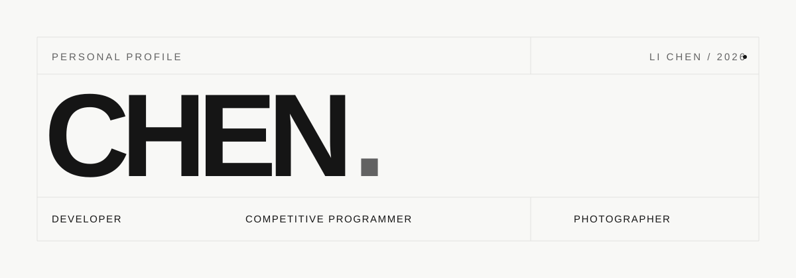

 

  <picture>
    <source media="(prefers-color-scheme: dark)" srcset="./assets/hero-dark.svg">
    <source media="(prefers-color-scheme: light)" srcset="./assets/hero-light.svg">
    
  </picture>

  <a href="https://chen2009.top">Website</a> &nbsp; / &nbsp;
  <a href="https://blog.chen2009.top">Blog</a> &nbsp; / &nbsp;
  <a href="https://space.bilibili.com/674991004">Bilibili</a> &nbsp; / &nbsp;
  <a href="mailto:lichen143@outlook.com">Email</a>

 

### 01 — About

Hi, I'm **Chen** — a student developer, competitive programming enthusiast, and photographer.

I enjoy turning ideas into meaningful digital experiences, solving algorithmic challenges, and capturing moments through photography.

Driven by curiosity. Focused on the details.

### 02 — What I Do

| DEVELOPMENT | COMPETITIVE PROGRAMMING | PHOTOGRAPHY |
| :--- | :--- | :--- |
| Building modern web experiences and useful tools. | Exploring algorithms, data structures, and problem solving. | Capturing landscapes, portraits, and everyday moments. |

### 03 — Tech Stack

**Languages**  
`C++` · `JavaScript` · `TypeScript` · `Python`

**Frameworks & Runtime**  
`Vue` · `React` · `Node.js`

**Tools & Technologies**  
`Git` · `MySQL` · `Markdown`

### 04 — Selected Projects

**01 / [Chen's Website](https://chen2009.top)**  
Personal website · Portfolio

A digital space showcasing my projects, photography, and creative experiments.

**02 / [Chen Blog](https://github.com/LiChen0459/chenBlog)**  
Open Source · Blogging

A place to document what I learn, share technical insights, and explore new ideas.

**03 / [Heart Order · 心序](https://heart-order.chen2009.top/)**  
Interactive Web · Personality & Relationships

An interactive experience exploring personality, relationships, and meaningful connections.

### 05 — Get in Touch

Have an idea, a question, or just want to say hello?

**[lichen143@outlook.com](mailto:lichen143@outlook.com)**

---

  CODE &nbsp; / &nbsp; CREATE &nbsp; / &nbsp; CAPTURE

